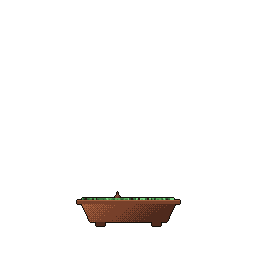

<!-- ╔══════════════════════════════════════════════════════════╗ -->
<!--                        HEADER                              -->
<!-- ╚══════════════════════════════════════════════════════════╝ -->

<picture>
  <source media="(max-width: 600px)" srcset="https://capsule-render.vercel.app/api?type=waving&color=0%3A0D1117%2C25%3A001A2E%2C55%3A00838F%2C80%3A00BFBF%2C100%3A0BFFCF&height=260&section=header&text=Vinicius+Lago+Cruz&fontSize=64&fontColor=FFFFFF&animation=fadeIn&fontAlignY=38&desc=Full+Stack+Developer+%7C+IT+Infrastructure+Analyst&descSize=24&descAlignY=65&descColor=AFFFFF" />
  
</picture>

&nbsp;&nbsp;&nbsp;&nbsp;

 

[Projetos](#projetos) &nbsp;·&nbsp; [Stack](#stack) &nbsp;·&nbsp; [Experiência](#experiencia) &nbsp;·&nbsp; [Bonsai & snake](#jardim) &nbsp;·&nbsp; [Métricas](#metricas)

<picture>
  <source media="(max-width: 600px)" srcset="https://capsule-render.vercel.app/api?type=soft&color=0%3A1A003A%2C100%3A6E00D4&height=86&text=SOBRE+MIM&fontSize=36&fontColor=FFFFFF&fontAlignY=60" />
  
</picture>

**Desenvolvedor Full Stack com 4+ anos de trajetória em TI na DAX Oil Refino S.A.** Atuo como Coordenador de TI & Dev Full Stack no Projeto DAX Code e Analista de Infraestrutura e Suporte na operação da refinaria.

Projeto, desenvolvo e mantenho sistemas internos usados por mais de 60 pessoas por dia: do requisito ao banco de dados, do código ao servidor.

Engenharia de Software · UCSAL · 8º semestre · conclusão prevista: dez/2026 Camaçari, Bahia

<picture>
  <source media="(max-width: 600px)" srcset="https://capsule-render.vercel.app/api?type=soft&color=0%3A002200%2C100%3A004D1A&height=86&text=TECH+STACK&fontSize=36&fontColor=00FF88&fontAlignY=60" />
  
</picture>

**Sistemas & APIs**

PHP / Laravel nos sistemas DAX · C# / .NET no [SGQ](https://github.com/ViniciusLgo/SGQ) · Java / Spring no [MovieFlix](https://github.com/ViniciusLgo/Movieflix).

**Interfaces & web 3D**

React, Next.js e TypeScript no [MeuSemestre](https://github.com/ViniciusLgo/MeuSemestreUcsal) · Three.js no [Thiago Guinchos](https://github.com/ViniciusLgo/thiago-guinchos-site) · HTML e CSS na base.

**Dados & persistência**

Python / pandas e SQL no [Microcrédito](https://github.com/ViniciusLgo/bigdata-microcredito-project) · PostgreSQL, MySQL e Supabase nas aplicações.

**Infraestrutura & entrega**

Infraestrutura de TI, versionamento e CI · Terraform aplicado à configuração do projeto acadêmico de Microcrédito.

<picture>
  <source media="(max-width: 600px)" srcset="https://capsule-render.vercel.app/api?type=soft&color=0%3A1A0800%2C100%3A5C2800&height=86&text=PROJETOS+EM+DESTAQUE&fontSize=36&fontColor=FF8C00&fontAlignY=60" />
  
</picture>

Produto para estudantes · processos de qualidade · engenharia de dados · interfaces 3D

<table width="100%" cellpadding="10">

<tr>
<td width="72" valign="top" align="center"></td>
<td valign="top">

**MeuSemestreUCSAL** &nbsp;&nbsp;

Plataforma que ajuda alunos da UCSAL a planejar a matrícula e avaliar professores antes de fechar o semestre. Login sem senha (OTP), dados protegidos por Row Level Security e notificações administrativas via Telegram.

Next.js 16 · TypeScript · Supabase · Tailwind CSS 4

**Na prática:** autenticação, moderação e planejamento de horários.

[Demo](https://meu-semestre-ucsal.vercel.app/) &nbsp;·&nbsp; [Código](https://github.com/ViniciusLgo/MeuSemestreUcsal)

</td>
</tr>

<tr><td colspan="2"></td></tr>

<tr>
<td width="72" valign="top" align="center"></td>
<td valign="top">

**SGQ · Gestão da Qualidade** &nbsp;

Sistema para acompanhar reclamações de clientes, não conformidades e recalls. Perfis de acesso, aprovações por responsáveis distintos, auditoria e rastreabilidade dos requisitos.

C# · .NET 10 · ASP.NET Core MVC · Entity Framework Core · PostgreSQL

**Na prática:** Regras de negócio · autorização · testes de arquitetura e integração.

[Código](https://github.com/ViniciusLgo/SGQ) &nbsp;·&nbsp; [Rastreabilidade](https://github.com/ViniciusLgo/SGQ/blob/main/docs/produto/matriz-rastreabilidade.md)

</td>
</tr>

<tr><td colspan="2"></td></tr>

<tr>
<td width="72" valign="top" align="center"></td>
<td valign="top">

**Microcrédito & Inclusão Financeira** &nbsp;

Projeto acadêmico com dados abertos do Banco Central: extração, tratamento com pandas, modelagem dimensional e carga em PostgreSQL. O repositório também contém configuração Terraform. Desenvolvido com Roberto Luis Jr., Guilherme Chaves e Maria Fernanda Prandi.

Python · pandas · PostgreSQL · Terraform

**Na prática:** Engenharia de dados · SQL · colaboração.

[Código](https://github.com/ViniciusLgo/bigdata-microcredito-project) &nbsp;·&nbsp; [Pipeline ETL](https://github.com/ViniciusLgo/bigdata-microcredito-project/tree/main/etl)

</td>
</tr>

<tr><td colspan="2"></td></tr>

<tr>
<td width="72" valign="top" align="center"></td>
<td valign="top">

**Thiago Guinchos · Web 3D** &nbsp;

Site institucional com uma cena de resgate em Three.js conduzida pela rolagem. Adaptação para celular, alternativa sem WebGL e suporte à preferência por movimento reduzido.

JavaScript · Three.js · HTML · CSS

**Na prática:** Interfaces · animação 3D · acessibilidade.

[Código](https://github.com/ViniciusLgo/thiago-guinchos-site) &nbsp;·&nbsp; [Cena 3D](https://github.com/ViniciusLgo/thiago-guinchos-site/blob/main/src/cena.js)

</td>
</tr>

</table>

<picture>
  <source media="(max-width: 600px)" srcset="https://capsule-render.vercel.app/api?type=soft&color=0%3A001A2E%2C100%3A00838F&height=86&text=SISTEMAS+NA+DAX+OIL&fontSize=36&fontColor=AFFFFF&fontAlignY=60" />
  
</picture>

Desenvolvimento e sustentação de sistemas internos na rotina da empresa.

<table width="100%" cellpadding="10">

<tr>
<td width="72" valign="top" align="center"></td>
<td valign="top">

**DaxCode Platform** &nbsp;

Sistema de gestão e recrutamento (SGE + Candidatos) que eu projeto, desenvolvo e mantenho sozinho, usado por mais de 60 pessoas todos os dias na DAX Oil. privado, sistema interno DAX Oil

PHP 8.4 · Laravel 12 · MySQL · Cloudflare

</td>
</tr>

<tr><td colspan="2"></td></tr>

<tr>
<td width="72" valign="top" align="center"></td>
<td valign="top">

**DAX Control Center** &nbsp;

Painel interno pra controlar ativos de TI, abrir chamados e acompanhar a infraestrutura da DAX Oil, do parque de máquinas ao suporte ao usuário final. privado, sistema interno DAX Oil

PHP · Laravel · MySQL · Bootstrap

</td>
</tr>

</table>

### 🧪 Laboratório de código

Também mantenho projetos de estudo e experimentação:

- **[MovieFlix API](https://github.com/ViniciusLgo/Movieflix)** — Java / Spring Boot, autenticação JWT, Swagger e Flyway. Projeto do curso Java 10x.
- **[GuinchoTrack](https://github.com/ViniciusLgo/guinchotrack)** — React, componentes reutilizáveis, paginação e notificações com Context API. Projeto acadêmico.
- **[RoboEstudo](https://github.com/ViniciusLgo/Bot-Estudo-Sistema-Emabarcados)** — aplicação de terminal em Python com quizzes, flashcards e progresso local para estudar Sistemas Embarcados.

<a href="https://github.com/ViniciusLgo?tab=repositories">Explorar todos os repositórios →</a>

<picture>
  <source media="(max-width: 600px)" srcset="https://capsule-render.vercel.app/api?type=soft&color=0%3A001800%2C100%3A003300&height=86&text=MEU+JARDIM+DE+COMMITS&fontSize=36&fontColor=00FF88&fontAlignY=60" />
  
</picture>

O bonsai cresce com o histórico; a snake percorre as contribuições.

<picture>
  <source media="(prefers-color-scheme: dark)" srcset="https://raw.githubusercontent.com/ViniciusLgo/ViniciusLgo/output/github-contribution-grid-snake-dark.svg" />
  <source media="(prefers-color-scheme: light)" srcset="https://raw.githubusercontent.com/ViniciusLgo/ViniciusLgo/output/github-contribution-grid-snake.svg" />
  
</picture>

<picture>
  <source media="(max-width: 600px)" srcset="https://capsule-render.vercel.app/api?type=soft&color=0%3A001133%2C100%3A00438F&height=86&text=ATIVIDADE+NO+GITHUB&fontSize=36&fontColor=5DADE2&fontAlignY=60" />
  
</picture>

Atividade pública e distribuição de código. As linguagens refletem o volume nos repositórios analisados pelo serviço, não o nível de domínio de cada tecnologia.

  

Os cards são atualizados pelos serviços externos e podem usar períodos e caches diferentes.

 

**Vamos conversar sobre código, projetos e oportunidades.**

&ensp;

Vinicius Lago Cruz · Camaçari, BA · 2026

