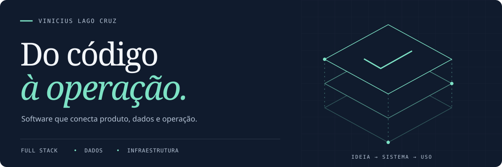

<picture>
  <source media="(max-width: 600px)" srcset="assets/brand/header-mobile.svg">
  
</picture>

# Vinicius Lago Cruz

**Desenvolvimento Full Stack · Dados · Infraestrutura** 
Software que conecta produto, dados e operação.

[LinkedIn](https://www.linkedin.com/in/viniciuslagocruz/) · [E-mail](mailto:vinicruzlago@gmail.com) · [Projetos](#projetos-selecionados) · [Competências](#competências-na-prática)

Sou desenvolvedor Full Stack com atuação em infraestrutura e suporte de TI. Desenvolvo aplicações web, APIs e soluções para organizar processos e dados, conectando a implementação às necessidades de quem usa o sistema.

Minha trajetória na **DAX Oil** reúne desenvolvimento de sistemas internos e operação de TI. Nos projetos públicos, trabalho com interfaces, regras de negócio, autenticação e processamento de dados.

Engenharia de Software · UCSAL &nbsp;/&nbsp; Camaçari, Bahia

---

## Projetos selecionados

### 01 / MeuSemestreUCSAL

**Produto para estudantes · Next.js, React e TypeScript**

Plataforma independente para avaliar professores e planejar a grade de horários. Reúne autenticação por e-mail, avaliações, moderação e organização da experiência do aluno, com PostgreSQL/Supabase e Tailwind CSS.

**O que demonstra:** desenvolvimento Full Stack, modelagem de dados, autenticação e interfaces de produto.

[Explorar projeto →](https://github.com/ViniciusLgo/MeuSemestreUcsal) · [Arquitetura e funcionalidades](https://github.com/ViniciusLgo/MeuSemestreUcsal#readme)

### 02 / SGQ

**Processos de qualidade · C#, ASP.NET Core e PostgreSQL**

Sistema para registrar e acompanhar reclamações de clientes, não conformidades e recalls. Reúne perfis de acesso, fluxos de aprovação, auditoria e rastreabilidade dos requisitos, com Entity Framework Core.

**O que demonstra:** tradução de processos em regras de negócio, autorização, persistência relacional e organização de testes de arquitetura e integração.

[Explorar projeto →](https://github.com/ViniciusLgo/SGQ) · [Matriz de rastreabilidade](https://github.com/ViniciusLgo/SGQ/blob/main/docs/produto/matriz-rastreabilidade.md)

### 03 / Microcrédito e inclusão financeira

**Projeto acadêmico em equipe · Python, pandas e PostgreSQL**

Pipeline de dados abertos do Banco Central para estudar microcrédito e inclusão financeira regional. Integra extração, tratamento, modelagem dimensional e carga no banco. O repositório também contém configuração de infraestrutura em Terraform.

**O que demonstra:** ETL, SQL, tratamento de dados, modelagem dimensional e colaboração. Desenvolvido com Roberto Luis Jr., Guilherme Chaves e Maria Fernanda Prandi.

[Explorar projeto →](https://github.com/ViniciusLgo/bigdata-microcredito-project) · [Pipeline de dados](https://github.com/ViniciusLgo/bigdata-microcredito-project/tree/main/etl)

### 04 / Thiago Guinchos

**Protótipo de site institucional · JavaScript e Three.js**

Uma experiência visual que apresenta o serviço de guincho por meio de uma cena de resgate em 3D conduzida pela rolagem. Inclui adaptação para celular, alternativa sem WebGL e tratamento para preferência por movimento reduzido.

**O que demonstra:** desenvolvimento de interfaces, animação 3D, acessibilidade e adaptação a dispositivos.

[Explorar projeto →](https://github.com/ViniciusLgo/thiago-guinchos-site) · [Construção da cena](https://github.com/ViniciusLgo/thiago-guinchos-site/blob/main/src/cena.js)

### Outros caminhos que exploro

- **[MovieFlix](https://github.com/ViniciusLgo/Movieflix)** — API de catálogo com Java, Spring Boot, JWT, PostgreSQL e Flyway. Projeto de estudo do curso Java 10x, com foco em APIs REST, autenticação e persistência.
- **[GuinchoTrack](https://github.com/ViniciusLgo/guinchotrack)** — painel acadêmico de frota em React, com filtros, paginação, abas e notificações globais via Context API. Foco em componentes reutilizáveis e gerenciamento de estado.

---

## Competências na prática

**Sistemas e APIs** 
PHP / Laravel na experiência com sistemas internos; C# / ASP.NET Core no SGQ; Java / Spring Boot no MovieFlix. Regras de negócio, autenticação, autorização e persistência.

**Interfaces e experiência de uso** 
TypeScript, React, Next.js, HTML e CSS. Produtos com fluxos de navegação, formulários, componentes e adaptação ao celular. Three.js para experiências visuais na web.

**Dados e integração** 
Python, pandas, SQL, PostgreSQL e MySQL. Extração e tratamento de dados, modelagem relacional e dimensional, integração entre aplicação e banco.

**Operação e qualidade** 
Experiência em infraestrutura e suporte de TI, conectada ao desenvolvimento de sistemas internos. Nos projetos públicos: Git, GitHub Actions, testes automatizados, documentação técnica e configuração de infraestrutura com Terraform.

## Da necessidade ao sistema

Na DAX Oil, minha atuação combina desenvolvimento e manutenção de sistemas internos com infraestrutura e suporte. Essa experiência aproxima o código da rotina de quem utiliza a solução: compreender o processo, organizar os dados, implementar o fluxo e acompanhar a operação.

O trabalho com **DaxCode** reúne sistemas de gestão e recrutamento; o **DAX Control Center** organiza ativos de TI e chamados. São projetos internos, com código privado.

---

<strong>Entre uma entrega e outra · atividade no GitHub</strong>

 

<picture>
  <source media="(prefers-color-scheme: dark)" srcset="https://raw.githubusercontent.com/ViniciusLgo/ViniciusLgo/output/github-contribution-grid-snake-dark.svg">
  <source media="(prefers-color-scheme: light)" srcset="https://raw.githubusercontent.com/ViniciusLgo/ViniciusLgo/output/github-contribution-grid-snake.svg">
  
</picture>

## Vamos conversar

Para conversar sobre desenvolvimento, projetos e oportunidades:

**[LinkedIn ↗](https://www.linkedin.com/in/viniciuslagocruz/)** &nbsp;·&nbsp; **[vinicruzlago@gmail.com](mailto:vinicruzlago@gmail.com)**

Vinicius Lago Cruz · Software, dados e operação.
